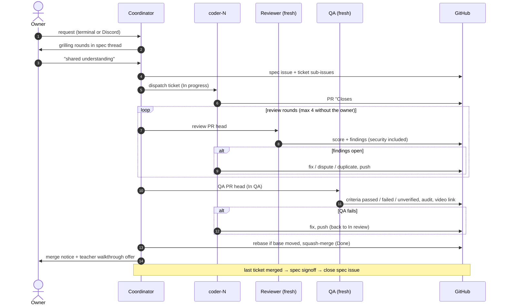
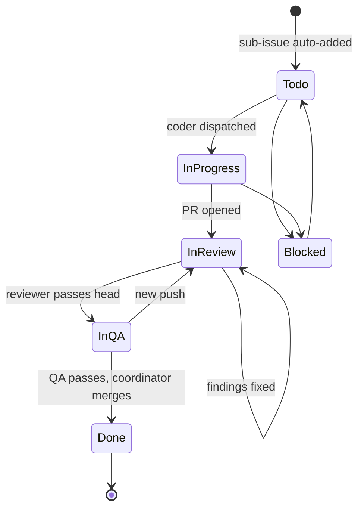

# cistack architecture

Draft from the design grilling. Terms follow [GLOSSARY.md](../GLOSSARY.md); the reasons behind the less obvious choices are in [docs/adr](adr/).

## Components

```mermaid
flowchart TB
    owner(["Owner"])

    subgraph discord["Discord server"]
        channel["#project channel<br/>approvals · merges · waiting on you"]
        specThread["Spec thread<br/>grilling · signoff"]
        ticketThread["Ticket threads<br/>coder · reviewer · QA talk"]
    end

    subgraph session["Coordinator session (Claude Code, launched with the Discord channel)"]
        coord["Coordinator<br/>the only Discord bot"]
        advisor["Advisor<br/>persistent · only with owner's OK"]
        teacher["Teacher<br/>persistent · Artifact pages"]
        subgraph perTicket["Per ticket: fresh agents"]
            coder["coder-N<br/>own worktree"]
            reviewer["Reviewer<br/>reads · scores · security"]
            qa["QA<br/>clean worktree · runs it"]
        end
    end

    subgraph github["GitHub"]
        spec["Spec issue"]
        tickets["Ticket sub-issues<br/>blocked-by links"]
        prs["Pull requests<br/>Closes #n"]
        board["Project board"]
    end

    subgraph machine["Owner's machine"]
        projectDocs["docs/agents/ (committed)<br/>board · commands · environments · domain docs"]
        state[".cistack/ (gitignored)<br/>secrets · models · status · lessons"]
        hooks["Hooks<br/>no unreviewed merge · no push to base<br/>no writes outside worktree"]
        worktrees["Worktrees"]
        transcripts["Transcripts"]
    end

    cistackRepo["cistack repo issues"]

    owner -- terminal --> coord
    owner -- "messages, @role to address" --> channel & specThread & ticketThread
    channel & specThread & ticketThread -- "delivered via bot" --> coord
    coord -- "bot replies" --> channel & specThread & ticketThread

    coord -- "dispatch / messages" --> coder & reviewer & qa
    coord -. "owner's OK" .-> advisor
    coord -- "on request" --> teacher

    coder & reviewer & qa & advisor & teacher -. "webhook posts<br/>own name + avatar" .-> ticketThread

    coord -- "writes" --> spec & tickets
    coord -- "moves cards · merges" --> board & prs
    coder -- opens --> prs
    reviewer & qa -- "verdicts" --> prs
    tickets --- board
    spec --- board

    coder & qa --- worktrees
    hooks -. guards .- coder & qa & coord
    coord --- state
    coord & coder & reviewer & qa --- projectDocs
    state & transcripts -- "/cistack:retro" --> cistackRepo
```

## One ticket's life

## Board

